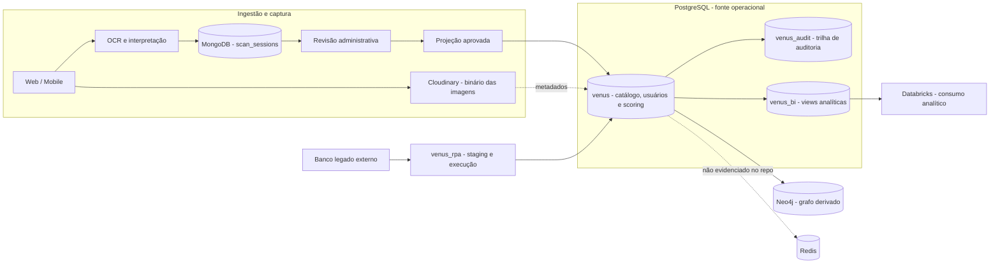

# Venus-Banco

Repositório de bootstrap, contratos e documentação da arquitetura de dados do
Venus. O projeto mantém o PostgreSQL operacional — catálogo, scoring, auditoria,
RPA e BI — e documenta as fronteiras com OCR, MongoDB, Neo4j, Redis, Cloudinary
e Databricks.

> **Regra de leitura:** o PostgreSQL foi validado diretamente no banco de QA.
> MongoDB e Neo4j possuem scripts de referência incorporados do pacote entregue;
> Redis e Databricks permanecem explicitamente limitados à evidência versionada.

## Navegação rápida

| Preciso entender… | Começo aqui |
|---|---|
| Arquitetura completa | [`docs/ARQUITETURA.md`](docs/ARQUITETURA.md) |
| Mapa por tecnologia | [`docs/arquitetura-dados/README.md`](docs/arquitetura-dados/README.md) |
| Todas as tabelas, campos e relacionamentos | [`docs/database-logical-model.md`](docs/database-logical-model.md) |
| Modelos lógicos editáveis | [`docs/modelos lógicos/README.md`](<docs/modelos lógicos/README.md>) |
| Instalação, bootstrap e validação | [`docs/OPERACAO.md`](docs/OPERACAO.md) |
| Contrato PostgreSQL | [`sql/README.md`](sql/README.md) |
| OCR e documento bruto | [`ocr/README.md`](ocr/README.md) e [`mongodb/README.md`](mongodb/README.md) |
| Grafo derivado | [`neo4j/README.md`](neo4j/README.md) |
| Mídia | [`cloudinary/README.md`](cloudinary/README.md) |
| ETL de ingredientes | [`data/ETL_INGREDIENTES/README.md`](data/ETL_INGREDIENTES/README.md) |

## Arquitetura ponta a ponta



### Como os dados atravessam a arquitetura

1. A aplicação envia a imagem pelo fluxo de upload assinado; o binário fica no
   Cloudinary e seus metadados ficam em `venus.media_assets`.
2. O OCR extrai texto, qualidade e candidatos; o contexto do scan é mantido em
   `MongoDB.scan_sessions`.
3. Casos ambíguos passam por revisão administrativa. Somente uma decisão
   aprovada pode iniciar a projeção relacional.
4. O PostgreSQL aplica FKs, checks, unicidades e regras de prontidão antes de
   promover produto, composição e scoring para uso operacional.
5. O núcleo relacional alimenta auditoria, recomendações, o grafo derivado e as
   views `venus_bi`.
6. O Databricks consome a camada analítica. Ele não deve escrever de volta no
   núcleo operacional.

O desenho usa linhas tracejadas para integrações que são metadados ou ainda não
possuem implementação comprovada no repositório.

## Estado real do PostgreSQL em QA

Validação executada em transação `READ ONLY` no banco `Venus-qa`, PostgreSQL
`17.11`, em 26/10/2026:

| Schema | Tabelas físicas | Papel |
|---|---:|---|
| `venus` | 59 | Núcleo transacional do catálogo, usuários, scoring e engajamento. |
| `venus_audit` | 1 | `audit_logs`, histórico de alterações. |
| `venus_rpa` | 4 | Execuções, staging e erros do legado. |
| `venus_optimization` | 1 | Ponto de extensão para otimização. |
| `venus_bi` | 0 | Camada de views analíticas, sem tabelas físicas. |
| **Total** | **65** | **79 FKs e 51 views/materialized views.** |

O snapshot completo é gerado por [`ops/generate_database_model.py`](ops/generate_database_model.py)
e documentado em [`docs/database-logical-model.md`](docs/database-logical-model.md).
O gerador consulta metadados e não cria, altera ou remove objetos no banco.

## O que está implementado

| Tecnologia | Status | Fonte no repositório |
|---|---|---|
| PostgreSQL | Implementado e validado em QA. | [`sql/`](sql/) |
| MongoDB | Contrato e scripts de `scan_sessions`; não executado nesta revisão. | [`mongodb/`](mongodb/) |
| Neo4j | Carga, constraints, seed e consultas; conector não versionado. | [`neo4j/`](neo4j/) |
| Redis | Sem código, configuração ou contrato evidenciado. | [`redis/README.md`](redis/README.md) |
| Cloudinary | Serviço backend e registro SQL de metadados. | [`cloudinary/`](cloudinary/) |
| Databricks | Consumidor documentado; sem notebooks/jobs no repo. | [`databricks/README.md`](databricks/README.md) |

## Executar localmente

### Pré-requisitos

- Python compatível com [`requirements.txt`](requirements.txt);
- acesso ao PostgreSQL Venus via `DATABASE_URL`;
- `LEGACY_DATABASE_URL` e queries do legado somente quando o RPA for executado;
- credenciais Cloudinary apenas no backend, nunca em payloads do cliente.

### Bootstrap sem RPA

```bash
python -m pip install -r requirements.txt
cp .env.example .env
python pipeline.py --skip-rpa
```

No PowerShell:

```powershell
Copy-Item .env.example .env
python pipeline.py --skip-rpa
```

### Regenerar a documentação SQL

```bash
python ops/generate_database_model.py
```

O comando exige `DATABASE_URL`, abre uma sessão somente leitura e atualiza os
artefatos em `docs/database-logical-model.*`. Não execute `--reset` ou modos de
reconstrução sem ler [`docs/OPERACAO.md`](docs/OPERACAO.md) e
[`docs/BACKUP_RECOVERY.md`](docs/BACKUP_RECOVERY.md).

## Estrutura do repositório

```text
Venus-Banco/
├── sql/                        # PostgreSQL, BI, RPA, seeds e migrations
├── mongodb/                    # scan_sessions, índices, seed e validação
├── neo4j/                      # grafo, constraints, cargas e consultas
├── redis/                      # status da integração Redis
├── databricks/                 # contrato de consumo analítico
├── ocr/                        # fluxo OCR e projeção de catálogo
├── cloudinary/                 # API, mídia e metadados
├── data/                       # ETL de ingredientes e fontes externas
├── docs/                       # arquitetura transversal e modelos lógicos
├── ops/                        # backup, restore e geração do snapshot
├── pipeline.py                 # bootstrap e orquestração do banco
├── rpa_migrate.py              # legado externo -> venus_rpa/venus
└── cloudinary_service.py       # operações backend-only de mídia
```

## Configuração essencial

| Variável | Finalidade |
|---|---|
| `DATABASE_URL` | Conexão do PostgreSQL Venus. |
| `LEGACY_DATABASE_URL` | Conexão somente leitura do legado para o RPA. |
| `LEGACY_PRODUCTS_QUERY` / `LEGACY_USERS_QUERY` | Consultas de extração do legado. |
| `CLOUDINARY_CLOUD_NAME` / `CLOUDINARY_API_KEY` | Upload e gestão de mídia. |
| `CLOUDINARY_API_SECRET` | Assinaturas backend-only; nunca expor ao cliente. |

A lista completa está em [`.env.example`](.env.example). Nunca versionar `.env`,
tokens, senhas, refresh tokens ou chaves privadas.

## Critérios para alterar o banco

1. Alterar `sql/00_schema.sql` ou criar uma migration idempotente.
2. Aplicar a mudança em QA e executar as validações estruturais.
3. Regenerar `docs/database-logical-model.*` pelo gerador somente leitura.
4. Atualizar os arquivos brModelo em [`docs/modelos lógicos/`](<docs/modelos lógicos/>).
5. Atualizar o contrato da tecnologia afetada e manter os limites de evidência
   explícitos.

Para a documentação completa, use [`docs/README.md`](docs/README.md).
