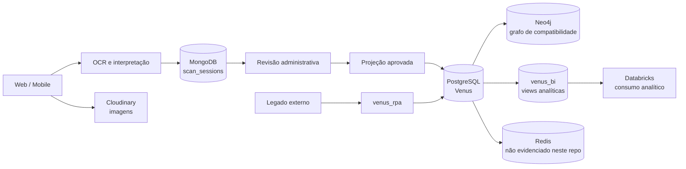

# Arquitetura de dados ponta a ponta

Esta pasta contém o mapa transversal da arquitetura. Os scripts e contratos de
cada tecnologia ficam nas pastas de primeiro nível do repositório: `sql/`,
`mongodb/`, `neo4j/`, `redis/`, `databricks/`, `ocr/` e `cloudinary/`.

## Fluxo canônico

## Papel de cada tecnologia

| Camada | Responsabilidade | Evidência disponível |
|---|---|---|
| OCR | Recebe imagens, extrai texto, resolve produto/ingredientes e gera uma decisão de revisão. | Contrato em [`../../ocr/README.md`](../../ocr/README.md). |
| Cloudinary | Armazena o binário das imagens; o PostgreSQL guarda metadados em `venus.media_assets`. | [`../../cloudinary/README.md`](../../cloudinary/README.md) e [`../../sql/05_cloudinary_images.sql`](../../sql/05_cloudinary_images.sql). |
| MongoDB | Mantém o documento de scan, OCR, fila administrativa e estado de sincronização. | [`../../mongodb/README.md`](../../mongodb/README.md). |
| PostgreSQL | Fonte operacional de produtos, ingredientes, usuários, scoring, auditoria, RPA e views. | Validado diretamente no banco `Venus-qa`; detalhes em [`../../sql/README.md`](../../sql/README.md). |
| Neo4j | Representa produtos, ingredientes, tipos ativos e relações de composição/compatibilidade. | [`../../neo4j/README.md`](../../neo4j/README.md). Não há conector de execução no repo. |
| Redis | Cache ou fila potencial. | Pasta explícita, sem contrato ou código Redis versionado. |
| Databricks | Consome a camada analítica para exploração, notebooks ou jobs. | [`../../databricks/README.md`](../../databricks/README.md). |

## Fronteiras de autoridade

- O PostgreSQL é a fonte de verdade operacional depois que uma projeção de OCR
  é aprovada.
- O MongoDB é a fonte do documento de captura e do workflow de revisão; ele não
  substitui as constraints do PostgreSQL.
- O Cloudinary é a fonte do binário de imagem; `venus.media_assets` é o registro
  canônico dos metadados e do vínculo com usuário, produto ou lista.
- O Neo4j recebe uma representação de grafo e não substitui as tabelas
  relacionais de composição e scoring.
- Redis e Databricks não devem ser tratados como implementados apenas por
  existirem no desenho. A documentação desses pontos descreve o limite da
  evidência disponível.

## Mapa técnico

- [`../../sql/README.md`](../../sql/README.md)
- [`../../mongodb/README.md`](../../mongodb/README.md)
- [`../../neo4j/README.md`](../../neo4j/README.md)
- [`../../redis/README.md`](../../redis/README.md)
- [`../../databricks/README.md`](../../databricks/README.md)
- [`../../ocr/README.md`](../../ocr/README.md)
- [`../../cloudinary/README.md`](../../cloudinary/README.md)
- [`architecture-overview.mmd`](architecture-overview.mmd)
