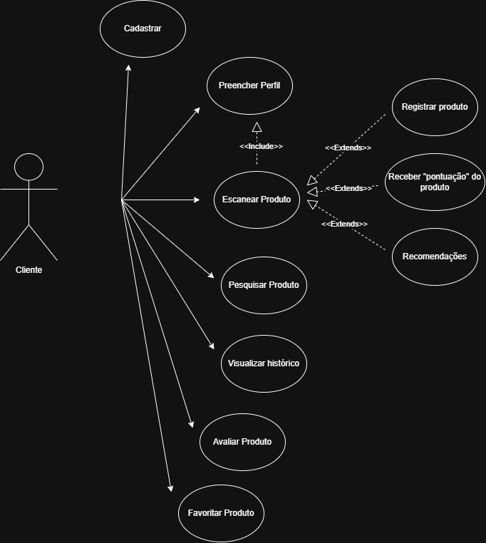
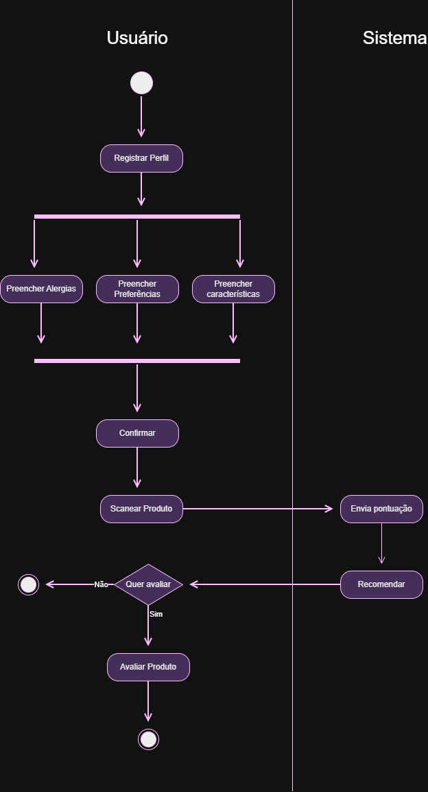

# Diagramas do projeto Venus em PNG

Esta pasta reúne os diagramas visuais usados na documentação de entrega da Engenharia e Qualidade de Software. Foram preservados os PNGs que já existiam nos repositórios e foram gerados PNGs a partir dos SVGs, fontes Mermaid e diagramas Mermaid incorporados à documentação consolidada.

## Evidências Draw.io da EQS

## Diagramas existentes nos repositórios

| Repositório | PNG | Origem |
|---|---|---|
| Venus-Banco | [arquitetura de dados](diagramas-png/venus-banco-arquitetura-dados.png) | `docs/arquitetura-dados/venus-data-architecture.svg` |
| Venus-Banco | [arquitetura resumida](diagramas-png/venus-banco-arquitetura-resumida.png) | `docs/arquitetura-dados/architecture-overview.mmd` |
| Venus-Banco | [modelo lógico](diagramas-png/venus-banco-modelo-logico.png) | `docs/database-logical-model.svg` |
| Venus-Banco | [schema venus](diagramas-png/venus-banco-schema-venus.png) | `docs/modelos lógicos/previews/schema-venus.png` |
| Venus-Banco | [schema venus_audit](diagramas-png/venus-banco-schema-venus-audit.png) | `docs/modelos lógicos/previews/schema-venus-audit.png` |
| Venus-Banco | [schema venus_rpa](diagramas-png/venus-banco-schema-venus-rpa.png) | `docs/modelos lógicos/previews/schema-venus-rpa.png` |
| Venus-AI-api | [arquitetura do sistema](diagramas-png/venus-ai-api-arquitetura-sistema.png) | Mermaid em `docs/arquitetura-sistema.md` |
| Venus-AI-api | [sequência do chat](diagramas-png/venus-ai-api-sequencia-chat.png) | Mermaid em `docs/arquitetura-sistema.md` |
| Venus-1ANO-CRUD | [fluxo em `src/assets`](diagramas-png/venus-1ano-crud-fluxo-src.png) | `src/assets/img/fluxo.png` |
| Venus-1ANO-CRUD | [fluxo em `webapp/assets`](diagramas-png/venus-1ano-crud-fluxo-web.png) | `src/main/webapp/assets/img/fluxo.png` |

## Diagramas Mermaid da documentação consolidada

| Tema | PNG |
|---|---|
| Arquitetura geral | [PNG](diagramas-png/venus-doc-arquitetura-geral.png) |
| Venus-CRUD | [PNG](diagramas-png/venus-doc-venus-crud.png) |
| Venus-Banco | [PNG](diagramas-png/venus-doc-venus-banco.png) |
| Venus-Classificacao | [PNG](diagramas-png/venus-doc-venus-classificacao.png) |
| Venus-AI-api | [PNG](diagramas-png/venus-doc-venus-ai-api.png) |
| Venus-AI-Sdk | [PNG](diagramas-png/venus-doc-venus-ai-sdk.png) |
| Venus-Web | [PNG](diagramas-png/venus-doc-venus-web.png) |
| Venus-mobile | [PNG](diagramas-png/venus-doc-venus-mobile.png) |
| Sequência ponta a ponta do scan | [PNG](diagramas-png/venus-doc-scan-sequencia.png) |
| Estados do scan | [PNG](diagramas-png/venus-doc-scan-estados.png) |
| Fluxo da IA | [PNG](diagramas-png/venus-doc-ia-fluxo.png) |
| Sequência da IA | [PNG](diagramas-png/venus-doc-ia-sequencia.png) |
| Classificação e recomendação | [PNG](diagramas-png/venus-doc-classificacao-recomendacao.png) |
| Rastreabilidade dos casos de uso | [PNG](diagramas-png/venus-doc-rastreabilidade-casos.png) |
| Rastreabilidade dos requisitos | [PNG](diagramas-png/venus-doc-rastreabilidade-requisitos.png) |
| Fluxo de rastreabilidade | [PNG](diagramas-png/venus-doc-rastreabilidade-fluxo.png) |
| CI/CD, deploy e operação | [PNG](diagramas-png/venus-doc-cicd-deploy.png) |

Os repositórios Venus-Classificacao, Venus-CRUD, Venus-Web, Venus-mobile e Venus-AI-Sdk também possuem descrições arquiteturais em README ou documentação; quando não havia um arquivo visual versionado, o diagrama correspondente foi exportado a partir do Mermaid usado na entrega consolidada.
