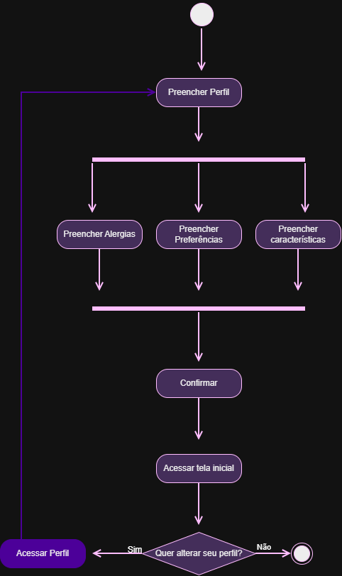

# Documentação de entrega e execução do projeto Venus EQS

> Relato consolidado de como o projeto Venus foi planejado, construído, integrado, validado e preparado para entrega.

**Snapshot:** 28/10/2026  
**Período planejado:** 15/05/2026 a 30/10/2026  
**Escopo:** Venus, anteriormente chamado de microScan

## 1. Escopo e leitura das fontes

Este documento reúne o planejamento local, o padrão de projeto, os diagramas Draw.io, a planilha de requisitos, o export completo do Jira e os repositórios públicos da organização Venus-System.

As fontes foram distinguidas por evidência:

- **Implementado:** comportamento descrito no código ou README de um repositório consultado.
- **Contrato documentado:** fronteira, schema, API ou fluxo descrito, ainda que o worker/conector não esteja no repositório.
- **Planejado ou pendente:** intenção do planejamento ou tarefa ainda não concluída no Jira.

## 2. Resumo executivo

O Venus foi entregue como uma plataforma inteligente de análise personalizada de cosméticos. O usuário cria um perfil, informa características, alergias e preferências, pesquisa ou escaneia um produto e recebe uma análise combinando qualidade, saúde, impacto ambiental, cruelty-free, compatibilidade e recomendações.

A entrega foi organizada em um ecossistema composto por:

- **Venus-Web:** interface React/TypeScript.
- **Venus-mobile:** aplicativo Android em Java/XML.
- **Venus-CRUD:** API central de dados, catálogo, usuários, scoring, favoritos, avaliações, mídia e scans.
- **Venus-Classificacao:** cálculo determinístico da nota e compatibilidade.
- **Venus-AI-api:** API FastAPI do chat.
- **Venus-AI-Sdk:** grafo multiagente em LangChain/LangGraph.
- **Venus-Banco:** fonte de verdade do contrato de dados, PostgreSQL, MongoDB, OCR, RPA, auditoria, Neo4j e BI.

A decisão arquitetural aplicada foi separar verdade operacional, cálculo determinístico e linguagem natural: PostgreSQL guarda o catálogo e as regras; Classificação calcula o score; IA consulta ferramentas/evidências e explica o resultado sob guardrails e validação do juiz.

## 3. Fontes consolidadas

| Fonte | Conteúdo incorporado |
|---|---|
| Planejamento Venus | objetivo, visão, stack, dinâmica, papéis, escopo, fases, riscos, qualidade e entregáveis |
| Padrão de Projeto.docx | padrão Repository aplicado ao Venus-CRUD |
| Requisitos.xlsx | 131 requisitos funcionais, técnicos, de segurança, UX e não funcionais |
| Draw.io de casos de uso | cadastro, perfil, scan, pesquisa, histórico, avaliação, favoritos, pontuação e recomendação |
| Draw.io de atividades | fluxos de perfil e escaneamento |
| Texto colado do Jira | 170 itens com chave, tipo, responsável, status, prioridade e datas |

### Repos do projeto

- [Venus-CRUD](https://github.com/Venus-System/Venus-CRUD)
- [Venus-Banco](https://github.com/Venus-System/Venus-Banco)
- [Venus-Classificacao](https://github.com/Venus-System/Venus-Classificacao)
- [Venus-AI-api](https://github.com/Venus-System/Venus-AI-api)
- [Venus-AI-Sdk](https://github.com/Venus-System/Venus-AI-Sdk)
- [Venus-Web](https://github.com/Venus-System/Venus-Web)
- [Venus-mobile](https://github.com/Venus-System/Venus-mobile)
- [.github](https://github.com/Venus-System/.github)

## 4. Objetivo, visão e escopo

### 4.1 Problema

Rótulos de cosméticos são extensos e técnicos. O Venus converte ingredientes, claims, perfil e regras de segurança em uma leitura personalizada, explicável e acionável.

### 4.2 Fluxo principal

1. Criar conta e autenticar.
2. Preencher perfil, características, alergias e preferências.
3. Pesquisar ou escanear código de barras/rótulo.
4. Identificar produto, versão e ingredientes.
5. Calcular score e compatibilidade.
6. Exibir alertas, motivos, explicação e recomendações.
7. Permitir favoritar, comparar, avaliar e consultar histórico.
8. Responder perguntas pelo chatbot com dados do catálogo e do perfil.

### 4.3 Funcionalidades

- cadastro, login Google, e-mail/senha, recuperação e verificação;
- onboarding, home, navegação e perfil;
- pele, cabelo, couro cabeludo, alergias, objetivos e preferências;
- código de barras, foto, OCR e normalização de ingredientes;
- catálogo de produtos, marcas, categorias, ingredientes, aliases e propriedades;
- composição, ordem no rótulo e concentração estimada;
- scores de saúde, ambiental, cruelty-free, transparência e personalizados;
- regras por perfil, alergia, sensibilidade, sustentabilidade e ética;
- explicação, alertas, recomendação, ranking e comparação;
- favoritos, listas, histórico, avaliações e notificações;
- chatbot, fontes, metodologia e referências;
- administração, moderação, correção manual, auditoria e BI;
- versões de produto, versões de score e rastreabilidade.

Evoluções registradas: feed social, badges, gamificação, rotinas, custo-benefício, APIs públicas, BI avançado, B2B, certificação, extensão de navegador, e-commerce e compatibilidade de rotinas.

## 5. Stack

| Camada | Tecnologia | Papel |
|---|---|---|
| Web | React, TypeScript, Vite, React Router | interface e conteúdo |
| Mobile | Android Java/XML | câmera, scanner, OCR e experiência móvel |
| Backend | Spring Boot, Java 21 | APIs de dados |
| Classificação | Spring Boot, Java 21 | score determinístico |
| IA | FastAPI, Python, LangChain, LangGraph | chat e agentes |
| Auth | Firebase Authentication | identidade |
| Relacional | PostgreSQL, schema venus | fonte de verdade |
| Documental | MongoDB | scan, memória e histórico |
| Cache | Redis | cache e estados voláteis |
| Mídia | Cloudinary | binários de imagem |
| Grafo | Neo4j | relações derivadas de rotina |
| BI | views venus_bi e Databricks consumidor | indicadores |
| Entrega | Docker, GitHub Actions, GHCR, EC2/systemd | CI/CD |

## 6. Organização da equipe

O planejamento inicial define a dinâmica de trabalho, os responsáveis por cada frente e os ciclos de integração. Para esta versão, os papéis oficiais ficam consolidados como:

| Pessoa | Papel oficial | Atuação principal |
|---|---|---|
| Matheus Orestes | Scrum Master | arquitetura completa de PostgreSQL, MongoDB e Neo4j; funcionalidade de scan; Engenharia e Qualidade de Software; hospedagem AWS da FastAPI e do CRUD; sprints e integração |
| Sophia Castro | Product Owner | visão do produto, priorização, IA, BI e aceite de valor |
| Felipe Augusto | Desenvolvimento e DevOps | backend, integrações, procedures, cache de favoritos no Redis, pipelines, Render e apoio à operação |
| Henrique Akira | UX, Web e DAD | experiência, interface, rotas, componentes, Figma e acessibilidade |
| Laura Gonçalves | Execução de dados | execução operacional da arquitetura de PostgreSQL, MongoDB e Neo4j definida por Matheus Orestes; OCR e validações |
| Rafael Lopes | Mobile e observabilidade | mídia, observabilidade e integração móvel |

### Fotos e perfis do GitHub

As imagens abaixo apontam para os avatares públicos dos perfis que aparecem nos commits dos repos do projeto.

| Pessoa | Perfil GitHub | Foto |
|---|---|---|
| Felipe Augusto | [FelipeAugustoSan](https://github.com/FelipeAugustoSan) |  |
| Henrique Akira | [Akira-132](https://github.com/Akira-132) |  |
| Laura Gonçalves | [Laura-986](https://github.com/Laura-986) |  |
| Rafael Lopes | [rafasepol](https://github.com/rafasepol) |  |
| Sophia Castro | [Shhiaa](https://github.com/Shhiaa) |  |
| Matheus Orestes | [matheus-orestes](https://github.com/matheus-orestes) |  |

### Responsabilidades por área

A divisão abaixo segue a tabela de responsabilidades do planejamento original do ZIP. Matheus Orestes definiu toda a arquitetura dos bancos de dados — PostgreSQL, MongoDB e Neo4j —, toda a funcionalidade de scan e a hospedagem na AWS da FastAPI e do CRUD. Laura Gonçalves ficou responsável pela execução operacional dessa arquitetura.

| Matéria | Responsável | Suporte | Entregas |
|---|---|---|---|
| Modelagem de Dados | Matheus Orestes | Laura Gonçalves | entidades, relacionamentos, dicionário e integridade |
| Banco de Dados | Laura Gonçalves | Sophia Castro | execução operacional da arquitetura de PostgreSQL, MongoDB e Neo4j definida por Matheus Orestes |
| Desenvolvimento de aplicações dinâmicas | Henrique Akira | Felipe Augusto | fluxos, componentes e lógica de interface |
| Desenvolvimento Aplicativo Móvel | Rafael Lopes | Matheus Orestes | Android, autenticação, navegação e integração do scan |
| Desenvolvimento | Felipe Augusto | Laura Gonçalves | backend, APIs, procedures, integrações e cache de favoritos no Redis |
| IA | Sophia Castro | Rafael Lopes | agentes, RAG, explicações, chat e recomendações |
| BI | Sophia Castro | Matheus Orestes | pipeline, KPIs, métricas e dashboards |
| Engenharia e Qualidade de Software | Matheus Orestes | Laura Gonçalves | testes, TDD, validação, estabilidade e aceite |
| UX | Henrique Akira | Rafael Lopes e Sophia Castro | Figma, protótipos, acessibilidade e experiência |

**Nota sobre Operações Ágeis:** conforme a tabela do ZIP, Operações Ágeis ficou com **Felipe Augusto**, com suporte de **Henrique Akira**. A frente foi mantida fora da tabela principal porque a divisão solicitada para esta versão lista apenas as matérias acadêmicas.

## 7. Planejamento de execução e metas semanais

O projeto começou em **15/05/2026**, conforme o planejamento inicial, e teve como data de fechamento **30/10/2026**. A execução foi organizada em duas camadas: primeiro, as etapas de fundação e preparação; depois, as 12 semanas finais detalhadas no documento Metas Semanais.

Como o documento Metas Semanais informa a duração de 12 semanas e fixa o encerramento da Semana 12 em 30/10/2026, as semanas foram distribuídas em blocos consecutivos de sete dias, de sábado a sexta-feira. Assim, a primeira semana detalhada corresponde a 08/08–14/08 e a última a 24/10–30/10.

### 7.1 O que foi feito antes das 12 metas semanais

#### 15/05/2026–21/06/2026 — Concepção e modelagem inicial

Foi consolidado o conceito do Venus como plataforma de análise personalizada de cosméticos. A equipe organizou o board, definiu a dinâmica de trabalho, iniciou a modelagem do banco e alcançou aproximadamente 60% da base inicial de dados.

#### 22/06/2026–05/07/2026 — Fundação, requisitos e escopo

Foram fechados os requisitos, a arquitetura inicial, o backlog, os riscos e o recorte da versão. Também foram definidos os casos de uso, a divisão de responsabilidades e a estratégia de integração entre Web, Mobile, backend, classificação, IA e dados.

#### 06/07/2026–26/07/2026 — Modelagem e base relacional

Foram modeladas entidades, relacionamentos, cardinalidades, constraints, índices e dados iniciais. O schema, o dicionário de dados e o seed foram preparados para sustentar catálogo, ingredientes, perfis, scoring, favoritos, avaliações e histórico.

#### 27/07/2026–07/08/2026 — Primeira implementação de serviços

Matheus Orestes definiu a arquitetura completa de PostgreSQL, MongoDB e Neo4j e implementou a base da funcionalidade de scan. Também foram preparados os contratos de integração, a estrutura do aplicativo e os primeiros pontos de conexão com OCR, MongoDB e classificação.

A fase original de backend prevista para 27/07–16/08 continuou na Semana 1 das metas detalhadas. Portanto, as 12 semanas abaixo são o detalhamento operacional da reta final, não um novo início do projeto.

### 7.2 As 12 semanas finais de execução

#### Semana 1 — 08/08/2026–14/08/2026 — Fundação e UX

**Como foi feito**

- O backlog do MVP foi fechado.
- A arquitetura foi definida.
- A estrutura do PostgreSQL e do MongoDB foi revisada.
- O protótipo navegável da jornada principal foi concluído.
- O ambiente de desenvolvimento do chatbot, a estrutura do projeto e a API inicial foram configurados e documentados.

**Critério de entrega**

- Todas as telas do App e da Web foram criadas e prototipadas no Figma.
- O fluxo foi definido e apresentado à equipe.
- O MongoDB foi modelado e colocado online.
- O SQL foi populado em QA com a base de ingredientes utilizada.
- O ambiente virtual e as variáveis de ambiente da IA foram configurados.

#### Semana 2 — 15/08/2026–21/08/2026 — Base técnica

**Como foi feito**

- Os fluxos mobile e OCR foram iniciados.
- O schema SQL de produção foi travado.
- A estrutura inicial do MongoDB foi finalizada.
- A API começou a receber as primeiras implementações.
- O pipeline de DevOps foi estruturado.
- O agente explicador de ingredientes foi implementado com RAG integrado ao PostgreSQL e ao Open Beauty Facts.
- O repositório Web e sua estrutura inicial foram finalizados, com publicação inicial.

**Critério de entrega**

- As telas principais ficaram com navegação definida.
- As tabelas principais ficaram sem dúvidas estruturais.
- Os repos do projeto passaram a receber commits continuamente.
- O pipeline de testes de DevOps ficou em andamento.
- O MongoDB foi ajustado quando necessário.

#### Semana 3 — 22/08/2026–28/08/2026 — Modelo de domínio

**Como foi feito**

- Categorias, tags, claims e modelos de score foram definidos.
- As regras de classificação do usuário foram fechadas.
- O início da API de classificação ficou registrado como em andamento (➖).
- O orquestrador multiagente foi desenvolvido com LangGraph.
- O chatbot foi integrado ao fluxo de roteamento.
- A implementação do Redis ficou registrada como em andamento (➖). No código da develop, o Redis também aparece no Venus-CRUD para o cache dos favoritos, e os CacheConfig do CRUD e da Classificação pertencem à frente que implementou esses serviços.
- A aplicação Web foi publicada na Vercel.
- Tokens de estilo, tipos de domínio, services e componentes-base do DAD foram implementados.

**Critério de entrega**

- O banco passou a suportar consultas reais do produto.
- A IA identificou a intenção e encaminhou cada solicitação ao agente apropriado.
- O endpoint /explicar-ingrediente permaneceu registrado como em andamento (➖) no documento de metas; ele não é descrito aqui como concluído.
- O endereço público ficou acessível e os componentes-base atenderam aos requisitos de teclado e descrição.

#### Semana 4 — 29/08/2026–04/09/2026 — API base

**Como foi feito**

- Foram implementados os CRUDs de usuários, produtos, ingredientes e perfis.
- A autenticação foi integrada.
- A conexão com SQL foi estabilizada.
- A documentação das primeiras rotas ficou registrada como em andamento (➖).
- Foram entregues as telas de Pesquisa e Produto no estado sem perfil.
- Foi criada a rota de erro da Web.

**Critério de entrega**

- O frontend passou a consumir endpoints reais.
- Os scripts de consulta aos bancos para a IA ficaram em desenvolvimento.
- Foi possível buscar um produto, abrir a análise pública e retornar, com estados de carregamento, sucesso e erro visíveis.

#### Semana 5 — 05/09/2026–11/09/2026 — App mobile base

**Como foi feito**

- A navegação principal do aplicativo foi implementada.
- Foram entregues as telas de autenticação, início e perfil.
- A estrutura do scanner foi criada.
- Os agentes restantes foram integrados com persistência de contexto no MongoDB.
- Foram implementadas as telas Sobre, Metodologia e Fontes.
- O contexto de autenticação e a rota privada do DAD foram integrados.
- Foram iniciados filtros, animações e a modelagem do Neo4j.

**Critério de entrega**

- O aplicativo passou a se comportar como produto integrado.
- Os agentes funcionaram em conjunto e mantiveram histórico/contexto.
- O acesso deslogado a uma rota privada levou ao login e, após a autenticação, devolveu o usuário ao destino.

#### Semana 6 — 12/09/2026–18/09/2026 — Scanner

**Como foi feito**

- O Qdrant da IA foi preparado por Laura Gonçalves.
- Toda a funcionalidade de scan foi implementada por Matheus Orestes.
- A renderização de Markdowns foi implementada por Henrique Akira.
- A tela completa de perfil foi implementada por Henrique Akira.
- A tela completa de questionário foi implementada por Henrique Akira.
- Foram aplicados ajustes no banco.
- A validação de entrada e o retorno de erro por campo foram reforçados.

**Critério de entrega**

- Um scan básico percorreu o sistema sem quebrar.
- Respostas inadequadas foram bloqueadas ou reformuladas.
- Nenhum dado inválido chegou aos serviços.
- Cada erro foi apresentado junto ao campo responsável.

#### Semana 7 — 19/09/2026–25/09/2026 — Recomendação e score

**Como foi feito**

- Laura Gonçalves executou as alterações do MongoDB para ADMIN e OCR conforme a arquitetura definida por Matheus Orestes.
- Laura Gonçalves executou a implementação e a modelagem operacional do Neo4j conforme a arquitetura definida por Matheus Orestes.
- Sophia Castro trabalhou na tela de indicador de score e ingredientes.
- Henrique Akira corrigiu perguntas e implementou fluxo de administração, matriz de feature e proposta de valor.
- Rafael Lopes trabalhou na observabilidade da FastAPI.
- Sophia Castro corrigiu bugs do chat e das tools.
- Rafael Lopes e Matheus Orestes implementaram a frente de imagens.
- Matheus Orestes implementou a ingestion.
- Henrique Akira implementou componentes Modal, fluxo administrativo e tela DASH.
- Felipe Augusto trabalhou na hospedagem no Render.
- A API de CRUD com procedure foi preparada, mas a chamada da procedure só entrou em 27/10/2026; portanto, a entrega permaneceu parcial durante a Semana 7.

**Critério de entrega**

- O aplicativo devolveu valor ao usuário depois do scan.
- As interações passaram a ser registradas.
- Métricas e estimativas de utilização foram produzidas.
- As alterações de MongoDB para ADMIN/OCR e a modelagem do Neo4j foram incorporadas.

#### Semana 8 — 26/09/2026–02/10/2026 — Web UX e dashboard

**Como foi feito**

- Rafael Lopes implementou a tela de score e ingredientes e os ajustes de estilo.
- Matheus Orestes conduziu TDD nos repos do projeto.
- Henrique Akira implementou histórico, favoritos, comparação, scanner, chatbot Web, tela DASH, teste A/B e matriz pós-teste.
- Henrique Akira também corrigiu perguntas, fluxo de administração, matriz de feature e proposta de valor.
- Laura Gonçalves continuou a execução operacional do Neo4j conforme a arquitetura definida por Matheus Orestes.
- Rafael Lopes e Matheus Orestes continuaram a frente de imagens.
- Matheus Orestes continuou a ingestion.
- Felipe Augusto implementou a API de Classificação e avançou a hospedagem no Render.

Os itens repetidos em relação à Semana 7 foram tratados como continuidade e fechamento das frentes abertas.

**Critério de entrega**

- Web e Mobile passaram a contar a mesma história de produto, com conceitos e resultados alinhados.

#### Semana 9 — 03/10/2026–09/10/2026 — Carga robusta e validação

**Como foi feito**

- Sophia Castro consolidou a frente de BI.
- Henrique Akira realizou o trabalho de Jobs to be Done.
- Henrique Akira elaborou o relatório de melhorias e a versão 2.

**Critério de entrega**

- O produto foi demonstrado com massa de dados suficiente.
- Uma pessoa externa conseguiu executar o projeto seguindo o README do DAD.

#### Semana 10 — 10/10/2026–16/10/2026 — QA pesado

**Como foi feito**

- Matheus Orestes hospedou na AWS a FastAPI e o CRUD.
- Foram realizados testes de estabilidade e validação do fluxo principal.

**Critério de entrega**

- Nenhum ponto crítico interrompeu o fluxo principal.

#### Semana 11 — 17/10/2026–23/10/2026 — Release candidate

**Como foi feito**

- Foram executados os testes finais.
- Os ajustes restantes foram isolados para a etapa de fechamento.

**Critério de entrega**

- Restaram somente ajustes pequenos para a entrega.

#### Semana 12 — 24/10/2026–30/10/2026 — Fechamento e entrega

**Como foi feito**

- As telas previstas no Figma foram implementadas.
- O SQL ficou populado e operacional.
- O MongoDB ficou estruturado e operacional.
- O aplicativo foi preparado para publicação.
- A documentação final foi consolidada.
- A demo da apresentação foi preparada.

**Critério de entrega**

- O produto ficou demonstrável de ponta a ponta.

**Destaque final da execução**

> O fechamento registrou o orgulho pelo desempenho individual e coletivo e a celebração da ExpoTech: **1, 2, 3, Venus!**

## 8. Arquitetura geral

~~~mermaid
flowchart LR
    U["Usuário"] --> W["Venus-Web"]
    U --> M["Venus-mobile"]
    W --> F["Firebase Auth"]
    M --> F
    W --> C["Venus-CRUD"]
    M --> C
    W --> S["Venus-Classificacao"]
    M --> S
    W --> A["Venus-AI-api"]
    M --> A
    ADM["Administração"] --> C
    ADM --> S
    C --> PG[("PostgreSQL schema venus")]
    C --> MG[("MongoDB scan_sessions")]
    C --> CL["Cloudinary"]
    C -->|cache de favoritos| R
    S --> PG
    S -->|cache de análises| R[("Redis")]
    A --> SDK["Venus-AI-Sdk LangGraph"]
    SDK --> PG
    SDK --> MG
    SDK --> LLM["Groq / Mistral / Gemini"]
    SDK --> RAG["FAQ / Qdrant / índice local"]
    SDK --> MCP["MCP / Tavily"]
    SDK --> A2A["A2A"]
    SDK --> N4J[("Neo4j")]
~~~

### 8.1 Diagramas funcionais dos repos do projeto

Os diagramas abaixo explicam a responsabilidade e o fluxo principal de cada repo do projeto, complementando os diagramas de produto, scan, perfil, classificação e IA.

#### Venus-CRUD — API central de dados

~~~mermaid
flowchart LR
    client["Web / Mobile / Admin"] --> auth["Firebase token ou JWT admin"]
    auth --> controller["Controllers"]
    controller --> service["Services e regras"]
    service --> mapper["Mappers e DTOs"]
    service --> repo["Repositories"]
    repo --> pg[("PostgreSQL catálogo, usuários, scoring")]
    repo --> mongo[("MongoDB scan_sessions e OCR")]
    service --> cloud["Cloudinary mídia"]
    service --> openapi["Swagger / OpenAPI"]
~~~

#### Venus-Banco — contrato e governança de dados

O fluxo abaixo segue a arquitetura canônica documentada no próprio Venus-Banco. O binário da imagem é armazenado no Cloudinary e seus metadados chegam a media_assets. O OCR é executado no aplicativo com ML Kit; o aplicativo envia o texto, os candidatos e o contexto ao Venus-CRUD, que persiste a sessão no MongoDB. O Venus-CRUD não executa OCR nem chama a Classificação. Após a revisão administrativa, o estado vai de pending_review diretamente para approved ou rejected; somente a projeção aprovada entra no PostgreSQL. A Classificação é chamada diretamente pelo aplicativo para calcular score e motivos. O legado externo entra por RPA e staging, sem conexão direta com o aplicativo.

~~~mermaid
flowchart LR
    classDef entrada fill:#E8F1FF,stroke:#2563EB,color:#0F172A,stroke-width:1.5px
    classDef ingestao fill:#F0FDFA,stroke:#0F766E,color:#0F172A,stroke-width:1.5px
    classDef revisao fill:#FFF7ED,stroke:#C2410C,color:#0F172A,stroke-width:1.5px
    classDef calculo fill:#FDF4FF,stroke:#A21CAF,color:#0F172A,stroke-width:1.5px
    classDef operacional fill:#F5F3FF,stroke:#7C3AED,color:#0F172A,stroke-width:1.5px
    classDef derivado fill:#F8FAFC,stroke:#475569,color:#0F172A,stroke-width:1.5px
    classDef externo fill:#FEF2F2,stroke:#B91C1C,color:#0F172A,stroke-width:1.5px

    subgraph entrada["Entrada da aplicação"]
        app["Web / Mobile"]
        mlkit["OCR no app ML Kit"]
    end

    subgraph ingestao["Captura e persistência"]
        media["Cloudinary binário da imagem"]
        assets[("venus.media_assets metadados")]
        crud["Venus-CRUD persistência"]
        sessions[("MongoDB scan_sessions")]
    end

    subgraph governanca["Revisão e promoção"]
        review["Revisão administrativa"]
        decision{"pending_review"}
        approved["Projeção aprovada idempotency_key"]
        rejected["Rejeitado motivo"]
    end

    subgraph legado["Legado externo"]
        legacy["Fonte legada somente leitura"]
        rpa["venus_rpa RPA + staging"]
    end

    subgraph operacional["Fonte operacional"]
        pg[("PostgreSQL schema venus")]
    end

    subgraph calculo["Cálculo determinístico"]
        score["Venus-Classificacao score e motivos"]
    end

    subgraph derivados["Projeções e consumo"]
        audit["venus_audit"]
        graph["Neo4j grafo derivado"]
        bi["venus_bi views analíticas"]
        analytics["Databricks / analytics somente leitura"]
    end

    app -->|imagem| media
    media -->|metadados| assets
    assets --> pg
    app -->|captura| mlkit
    mlkit -->|texto, candidatos e qualidade| crud
    crud --> sessions
    sessions --> review
    review --> decision
    decision -->|aprovar| approved
    decision -->|rejeitar| rejected
    legacy --> rpa
    rpa -->|staging válido| approved
    approved -->|FKs, checks e unicidade| pg
    app -->|solicita análise| score
    pg -->|perfil, regras e catálogo| score
    score -->|score e motivos| pg
    pg --> audit
    pg --> graph
    pg --> bi
    bi --> analytics

    class app,mlkit entrada
    class media,assets,crud,sessions ingestao
    class review,decision,approved,rejected revisao
    class score calculo
    class pg operacional
    class audit,graph,bi,analytics derivado
    class legacy,rpa externo
~~~

Fonte: [Arquitetura de dados do Venus-Banco](https://github.com/Venus-System/Venus-Banco/blob/main/docs/ARQUITETURA.md).

#### Venus-Classificacao — score e compatibilidade

~~~mermaid
flowchart TD
    request["Solicitação de análise"] --> ownership["Autenticação e ownership"]
    ownership --> profile["Perfil, alergias e preferências"]
    ownership --> product["Produto, versão e ingredientes"]
    profile --> quality["Score de qualidade"]
    product --> quality
    quality --> rules["Perguntas, regras e bloqueios"]
    rules --> final["Nota, faixa, risco e motivos"]
    final --> persist["Persistência de análises e scores"]
    persist --> cache["Redis nos GETs"]
    persist --> response["DTO de resposta"]
~~~

#### Venus-AI-api — porta HTTP da inteligência

~~~mermaid
flowchart LR
    app["Web / Mobile"] --> firebase["Firebase Auth"]
    firebase --> api["FastAPI"]
    api --> limiter["Rate limit e observabilidade"]
    api --> sdk["Venus-AI-Sdk"]
    api --> memory["MongoDB memória e checkpointer"]
    sdk --> postgres["PostgreSQL tools estruturadas"]
    sdk --> rag["Qdrant ou índice local FAQ"]
    sdk --> llm["Groq / Mistral / Gemini"]
    sdk --> external["Tavily / MCP / A2A"]
    api --> answer["Resposta JSON"]
~~~

#### Venus-AI-Sdk — grafo multiagente

~~~mermaid
flowchart TD
    state["Estado Venus"] --> in["Guardrail de entrada"]
    in --> memory["Memória"]
    memory --> router["Router"]
    router --> product["Product"]
    router --> ingredient["Ingredient"]
    router --> routine["Routine"]
    router --> faq["FAQ e RAG"]
    product --> judge["Judge"]
    ingredient --> judge
    routine --> judge
    faq --> judge
    judge -->|feedback| specialist["Mesmo especialista"]
    specialist --> judge
    judge -->|aprovado| orchestrator["Orchestrator"]
    orchestrator --> out["Guardrail de saída"]
    out --> state2["Memória atualizada e resposta"]
~~~

#### Venus-Web — interface e serviços de frontend

~~~mermaid
flowchart TD
    browser["Navegador"] --> routes["React Router"]
    routes --> pages["Pages"]
    pages --> components["Components"]
    components --> contexts["Contexts e hooks"]
    contexts --> services["Services"]
    services --> firebase["Firebase"]
    services --> api["Venus-CRUD / Classificação / AI-api"]
    config["Config e mocks"] --> services
    api --> view["Produto, perfil, score, dashboard e chat"]
~~~

#### Venus-mobile — jornada móvel

~~~mermaid
flowchart TD
    user["Usuário Android"] --> auth["Login e cadastro"]
    auth --> home["Tela inicial"]
    home --> profile["Perfil"]
    home --> scanner["Scanner"]
    scanner --> barcode["Código de barras"]
    scanner --> photo["Foto e OCR"]
    barcode --> api["APIs Venus"]
    photo --> api
    api --> score["Score e recomendação"]
    api --> chat["Chatbot"]
    score --> history["Histórico, favoritos e avaliação"]
~~~

### 8.2 Venus-CRUD

É o dono dos dados operacionais. Usa controllers, DTOs, services, mappers e repositories.

~~~text
HTTP -> Controller -> Service -> Repository -> banco
             |             |
             |             +-> Mapper entity <-> DTO
             +-> validação, autorização e erro uniforme
~~~

PostgreSQL via JPA guarda catálogo, usuários, scoring e dados estruturados; o aplicativo executa o OCR com ML Kit e o Venus-CRUD persiste o resultado dos scans e do OCR no MongoDB; Cloudinary guarda binários. A API usa Java 21, Spring Boot 3.3.4, PostgreSQL 16, MongoDB 7, MapStruct, Lombok, Springdoc, Cloudinary, Testcontainers e Maven Wrapper.

### 8.3 Venus-Classificacao

Lê catálogo, regras, perfil, alergias e preferências do PostgreSQL. Calcula qualidade, compatibilidade, bloqueios, faixa e nota final. Persiste analysis_results, personalized_scores, rule_evaluations e product_scores.

A documentação informa:

- score de qualidade até 100;
- compatibilidade até 100%;
- qualidade valendo 35 pontos;
- compatibilidade valendo 65 pontos;
- alergia/bloqueio pode zerar ou limitar;
- faixas ideal, recomendado, aceitável, não recomendado e contraindicado;
- GETs com cache Redis por seis horas e fallback ao banco.

### 8.4 Venus-Web e Mobile

A Web separa páginas/componentes, services, contexts, hooks, types, config e mocks. Rotas incluem pesquisa, produto, sobre, metodologia, fontes, privacidade, termos, cookies, login, cadastro, recuperação, dashboard, perguntas e componentes.

O Mobile é Android nativo Java/XML com autenticação, câmera, scanner, OCR, perfil, chat, notificações e consumo da API. O README remoto do Mobile tem apenas o título; os detalhes vêm do planejamento e Jira.

## 9. Dados

### PostgreSQL

O Venus-Banco define o PostgreSQL como fonte de verdade de catálogo, usuários, composição, scoring, auditoria, RPA e BI. A validação registrada em 26/10/2026 indica 59 tabelas venus, 1 de auditoria, 4 RPA, 1 optimization, 65 no total, 79 FKs e 51 views/materialized views. ddl-auto validate faz a API validar, sem criar ou alterar schema.

### MongoDB

scan_sessions preserva imagens, OCR, candidatos, claims, ingredientes, revisão, projeção e tentativas. Estados: pending_review, approved, rejected, sync_failed e synced. O estado in_review não é utilizado no fluxo corrigido.

Mongo não substitui PostgreSQL. A aprovação autoriza projeção; FKs, unicidades e checks continuam no PostgreSQL.

### Cloudinary

Upload assinado: a API autentica, gera public_id e assinatura; o cliente envia o binário; a API valida e grava metadados em venus.media_assets. API secret nunca chega ao cliente.

### Redis

O Redis aparece no Venus-CRUD no cache dos favoritos e na Classificação nos GETs de análises por seis horas, com fallback ao banco. Os CacheConfig do CRUD e da Classificação pertencem à implementação dessas frentes; Redis não é atribuído à arquitetura de PostgreSQL/MongoDB/Neo4j de Matheus Orestes nem à execução operacional de Laura Gonçalves. O Venus-Banco continua sem implementação Redis própria, porque o cache é integração de serviço e não fonte de verdade.

### Neo4j e BI

Neo4j é projeção derivada de produtos, ingredientes, tipos de ativo e relações de compatibilidade/rotina. Há scripts e uma observação de correção necessária em uma constraint antes de execução; não há conector versionado no Venus-Banco.

Views venus_bi documentam dimensões, fatos, KPIs e rankings. Databricks é consumidor somente leitura; não há notebooks/jobs/Unity Catalog versionados no Venus-Banco.

## 10. Orquestração ponta a ponta do scan

~~~mermaid
sequenceDiagram
    autonumber
    actor U as Usuário
    participant APP as Web/Mobile
    participant AUTH as Firebase
    participant CRUD as Venus-CRUD
    participant MEDIA as Cloudinary
    participant ML as ML Kit no app
    participant MDB as Mongo scan_sessions
    participant ADM as Admin
    participant PG as PostgreSQL
    participant SCORE as Classificação
    participant AI as AI-api

    U->>APP: login e perfil
    APP->>AUTH: autentica
    AUTH-->>APP: ID token
    APP->>CRUD: solicita assinatura de mídia
    CRUD-->>APP: assinatura + public_id
    APP->>MEDIA: upload da foto
    MEDIA-->>APP: asset_id e URL
    APP->>ML: executa OCR local
    ML-->>APP: texto, candidatos e qualidade
    APP->>CRUD: registra sessão e contexto
    CRUD->>MDB: grava scan_sessions
    MDB-->>ADM: fila em pending_review
    ADM->>CRUD: aprova ou rejeita
    alt rejeitado
        CRUD->>MDB: rejected + motivo
        MDB-->>APP: correção solicitada
    else aprovado
        CRUD->>PG: projeta produto/versão/ingredientes
        PG-->>CRUD: valida integridade
        CRUD->>MDB: synced ou sync_failed
        APP->>SCORE: solicita nota diretamente
        SCORE->>PG: lê perfil/regras/catálogo
        SCORE->>PG: grava score e motivos
        SCORE-->>APP: nota, faixa, riscos
        APP->>AI: pergunta contextual
        AI->>PG: consulta evidências
        AI-->>APP: explicação controlada
    end
~~~

~~~mermaid
stateDiagram-v2
    [*] --> pending_review
    pending_review --> approved: revisão/aprovação
    pending_review --> rejected: revisão/rejeição
    approved --> synced: /sync concluído
    approved --> sync_failed: /sync falhou
    sync_failed --> synced: nova tentativa de /sync concluída
    sync_failed --> sync_failed: nova tentativa falhou
    rejected --> [*]
    synced --> [*]
~~~

A projeção deve ser idempotente para não duplicar produto, versão, composição e mídia em retries.

## 11. Orquestração da IA

O Venus-AI-Sdk implementa o grafo; Venus-AI-api injeta pools, checkpointer, store, índice RAG e tools.

| Agente | Função |
|---|---|
| Router | identifica intenção |
| Product | produto, score, ingrediente e alergia |
| Ingredient | propriedades e regulamentação |
| Routine | rotina e compatibilidade |
| FAQ | documentos, RAG e busca |
| Judge | valida resposta contra evidências |
| Orchestrator | escreve a resposta final |
| Memory | contexto por thread/usuário |

~~~mermaid
flowchart TD
    I["Mensagem"] --> GI["Guardrail de entrada"]
    GI -->|bloqueada| SAFE["Resposta segura"]
    GI -->|liberada| MI["Carregar memória"]
    MI --> R["Router"]
    R --> P["Product"]
    R --> ING["Ingredient"]
    R --> ROT["Routine"]
    R --> FAQ["FAQ/RAG"]
    P --> J["Judge"]
    ING --> J
    ROT --> J
    FAQ --> J
    J -->|reprovado| FB["Feedback"]
    FB --> P
    FB --> ING
    FB --> ROT
    FB --> FAQ
    J -->|aprovado ou limite atingido| O["Orchestrator"]
    O --> GO["Guardrail de saída"]
    GO --> MO["Atualizar memória"]
    MO --> OUT["Resposta"]
    SAFE --> OUT
~~~

Regras de confiabilidade:

- retry retorna ao mesmo especialista;
- há limite de tentativas;
- evidências brutas das tools entram no juiz;
- números, scores e alergias sem lastro são reprovados;
- texto reprovado não é entregue como verdade;
- falhas de LLM/memória usam degradação segura;
- tools de produto/ingrediente/rotina são estruturadas; RAG é principalmente FAQ;
- MCP/Tavily, A2A, Google Calendar e Neo4j são integrações opcionais/configuráveis;
- checkpointer guarda histórico por thread_id; store guarda memória longa por usuário.

~~~mermaid
sequenceDiagram
    actor U as Usuário
    participant API as AI-api
    participant G as Guardrails
    participant M as Memória
    participant R as Router
    participant E as Especialista
    participant J as Judge
    participant O as Orchestrator

    U->>API: mensagem + Firebase token
    API->>API: valida token e resolve user_id
    API->>G: estado inicial
    G->>M: carrega memória
    M->>R: mensagem e contexto
    R->>E: especialista
    loop até aprovação ou limite
        E->>E: chama tools/RAG/MCP
        E->>J: resposta + evidências
        J-->>E: aprovação ou feedback
    end
    J->>O: conteúdo aprovado/fallback
    O->>G: texto final
    G->>M: atualiza memória
    M-->>API: resposta
    API-->>U: JSON
~~~

## 12. Classificação e recomendação

~~~mermaid
flowchart LR
    Q["Request"] --> AUTH["Autenticação e ownership"]
    AUTH --> PROF["Perfil, alergias e preferências"]
    AUTH --> PROD["Produto, versão e ingredientes"]
    PROF --> QUAL["Qualidade"]
    PROD --> QUAL
    QUAL --> RULES["Perguntas, bloqueios e regras"]
    RULES --> FINAL["Nota, faixa, risco e motivos"]
    FINAL --> SAVE["Persistir análises e scores"]
    SAVE --> DTO["DTO"]
    DTO --> RESP["Resposta"]
    RESP -.-> CACHE["Redis: GET por 6h"]
~~~

A IA explica o resultado, mas não substitui a Classificação nem altera a fonte de verdade.

## 13. Casos de uso e atividades

### Diagramas Draw.io inseridos no corpo da entrega

As imagens acima foram geradas a partir dos três arquivos Draw.io originais do planejamento e ficam no mesmo diretório desta documentação para compor o corpo do texto.

### Rastreabilidade entre casos de uso e requisitos funcionais

A numeração abaixo segue a planilha Requisitos.xlsx. Os intervalos representam os requisitos funcionais cobertos pelo caso de uso; quando o diagrama original não explicita um caso de IA, a relação é registrada como complemento de rastreabilidade.

| Caso de uso | Requisitos funcionais relacionados |
|---|---|
| Cadastrar | 1 a 8 |
| Preencher perfil | 9 a 20 |
| Escanear produto | 21 a 26 |
| Registrar produto | 27 a 35 |
| Receber pontuação do produto | 36 a 51 |
| Recomendações | 52 a 56 |
| Visualizar histórico | 57 |
| Favoritar produto | 58 a 60 |
| Avaliar produto | 61 a 63 |
| Pesquisar produto | 69 a 72 |
| Chatbot/IA (complementar ao diagrama original) | 65 a 68 |

A leitura do diagrama é: Escanear produto inclui Registrar produto quando o item não existe e estende o fluxo para Receber pontuação e Recomendações. Os casos Cadastrar, Preencher perfil, Pesquisar produto, Visualizar histórico, Avaliar produto e Favoritar produto são acionados diretamente pelo cliente.

~~~mermaid
flowchart LR
    C((Cliente)) --> CAD([Cadastrar])
    C --> PERF([Preencher perfil])
    C --> SCAN([Escanear produto])
    C --> SEARCH([Pesquisar produto])
    C --> HIST([Visualizar histórico])
    C --> RATE([Avaliar produto])
    C --> FAV([Favoritar produto])
    SCAN -. include .-> REG([Registrar produto])
    SCAN -. extends .-> SCORE([Receber pontuação])
    SCAN -. extends .-> REC([Recomendações])
~~~

~~~mermaid
flowchart TD
    A((Início)) --> P["Preencher perfil"]
    P --> PREF["Preferências"]
    P --> CAR["Características"]
    P --> ALG["Alergias"]
    PREF --> OK["Confirmar"]
    CAR --> OK
    ALG --> OK
    OK --> HOME["Tela inicial"]
    HOME --> CHANGE{"Alterar perfil?"}
    CHANGE -->|Sim| ACCESS["Acessar perfil"]
    ACCESS --> P
    CHANGE -->|Não| END((Fim))
~~~

~~~mermaid
flowchart TD
    A((Início)) --> P["Registrar perfil"]
    P --> S["Scanear produto"]
    S --> N["Enviar pontuação"]
    N --> R["Recomendar"]
    R --> Q{"Quer avaliar?"}
    Q -->|Sim| E["Avaliar produto"]
    Q -->|Não| F((Fim))
    E --> F
~~~

## 14. Padrão Repository

O padrão documentado isola persistência. Services e controllers não carregam detalhes de query. Um ProductRepository estende JpaRepository<Product, Long>, herda operações comuns e pode declarar findBySlug(String slug) ou @Query para consultas complexas. Repositories JPA e Mongo ficam separados.

Benefícios:

- separação de responsabilidades;
- services mais legíveis;
- consultas localizadas;
- mudanças de persistência com menor impacto;
- métodos orientados ao domínio;
- menor exposição de detalhes de banco.

A composição arquitetural é Controller → Service → Repository, com DTOs, mappers e tratamento centralizado de exceções.

## 15. Segurança e privacidade

- Firebase token para usuários Web/Mobile;
- JWT próprio para administração;
- roles ADMIN, MODERATOR e ANALYST;
- ownership guard para recursos pessoais;
- user_id não deve ser aceito sem validação;
- API secret do Cloudinary somente no backend;
- assinatura de mídia curta e public_id controlado;
- guardrails contra prompt injection e dados sensíveis;
- memória isolada por usuário;
- IA sem tools livres de escrita;
- resposta segura em falha externa;
- fonte, metodologia, privacidade, termos e cookies documentados na Web.

## 16. Qualidade e aceite

Fluxos críticos: login, perfil, scan, análise, resultado e recomendação.

Critérios: OCR em várias condições, scores validados com cosméticos reais, texto claro e seguro, telas sem dados quebrados ou sobreposição, estabilidade, performance e usabilidade.

Evidências nos repositórios incluem testes de services, mappers, validators, security, ownership, Testcontainers, cálculo e travas de score, fallback de Redis, guardrails, tools, RAG, build/typecheck Web e validações SQL.

## 17. CI/CD, deploy e operação

~~~mermaid
flowchart LR
    PR["PR para develop/main"] --> CI["GitHub Actions JDK21 + mvnw verify"]
    CI --> MERGE["Merge"]
    MERGE --> BR{"Branch"}
    BR -->|develop| QA["Docker + testes"]
    QA --> GHCR["GHCR staging/develop-sha"]
    GHCR --> POLL["EC2 systemd poll"]
    POLL --> HEALTH["health check"]
    HEALTH -->|falha| RB["rollback"]
    HEALTH -->|sucesso| LIVE["QA atualizado"]
    BR -->|main| PROD["Docker + testes"]
    PROD --> LATEST["GHCR latest/main-sha"]
    LATEST --> PEND["host de produção não definido"]
~~~

O Venus-CRUD documenta CI em PR, imagens GHCR, deploy de QA por timer systemd e rollback. Main publica imagem, mas não possui host de produção definido. O Jira registra SCRUM-223 (deploy da API de classificação no EC2), SCRUM-224 (deploy da FastAPI no EC2) e SCRUM-15 (documento final de entrega) como itens não concluídos no snapshot.

Configuração usa .env, sem versionar segredos. Schema deve ser alterado no Venus-Banco antes de adaptar APIs. Backup PostgreSQL usa pg_dump custom e pg_restore; Cloudinary requer backup/estratégia separada para os binários.

## 18. Riscos e mitigação

| Risco | Mitigação |
|---|---|
| OCR impreciso | ML Kit, orientação de captura, normalização e revisão |
| banco atrasado | fechar modelo cedo e validar semanalmente |
| score inconsistente | pesos claros e casos reais |
| multi-banco complexo | contratos e escopo controlado |
| feature creep | congelamento de escopo |
| LLM indisponível | fallback e resposta segura |
| alucinação | tools, evidências, juiz, retry e guardrails |
| sync falho | status, idempotência e retry |
| schema divergente | ddl-auto validate e contrato central |

## 19. Status do Jira

O export possui 170 itens:

| Tipo | Quantidade |
|---|---:|
| Epic | 4 |
| História | 109 |
| Request | 29 |
| Tarefa | 25 |
| Subtask | 3 |

| Status | Quantidade |
|---|---:|
| Concluído | 167 |
| Sendo feito | 1 |
| Backlog | 1 |
| Tarefas pendentes | 1 |

| Responsável | Itens |
|---|---:|
| Henrique Akira | 51 |
| Sophia Castro | 32 |
| Rafael Lopes | 28 |
| Matheus Orestes | 27 |
| Felipe Augusto | 20 |
| Laura Gonçalves | 12 |

A progressão registrada foi descoberta → requisitos/modelagem → APIs e mobile → IA/multiagentes → scan/classificação → Web/chat/testes → documentação e deploy. A fonte viva das tasks é o [Jira do projeto](https://venus2026.atlassian.net/jira/software/projects/SCRUM/summary?ignoreStickyVersion=true).

## 20. Requisitos completos

A planilha contém 131 requisitos: 94 funcionais, 16 técnicos, 9 não funcionais, 7 UX e 5 segurança. Criticidade: 94 alta, 32 média e 5 baixa.

| # | Requisito | Categoria | Criticidade | Descrição |
|---:|---|---|---|---|
| 1 | Cadastro/autenticação | Funcional | Alta | Criação e acesso do usuário ao sistema via Firebase Auth. |
| 2 | Login com Google | Funcional | Alta | Permite autenticação rápida com conta Google. |
| 3 | Login com e-mail e senha | Funcional | Alta | Permite acesso tradicional por credenciais. |
| 4 | Recuperação de senha | Funcional | Alta | Permite redefinir senha em caso de perda de acesso. |
| 5 | Verificação de e-mail | Funcional | Média | Confirma a identidade do usuário e reduz contas falsas. |
| 6 | Logout | Funcional | Média | Permite encerrar a sessão com segurança. |
| 7 | Exclusão de conta | Funcional | Alta | Permite apagar o cadastro e os dados vinculados. |
| 8 | Aceite de termos e privacidade | Funcional | Alta | Solicita consentimento para uso dos dados. |
| 9 | Onboarding inicial | Funcional | Média | Apresenta o app e orienta o primeiro uso. |
| 10 | Tela inicial / home | Funcional | Alta | Centraliza acesso ao scanner, busca, favoritos e recomendações. |
| 11 | Navegação entre telas | Funcional | Alta | Permite transitar entre módulos do app de forma intuitiva. |
| 12 | Perfil do usuário | Funcional | Alta | Guarda as características pessoais usadas na personalização. |
| 13 | Cadastro do tipo de pele | Funcional | Alta | Registra se a pele é oleosa, seca, mista, sensível ou acneica. |
| 14 | Cadastro do tipo de cabelo | Funcional | Alta | Registra se o cabelo é liso, ondulado, cacheado ou crespo. |
| 15 | Cadastro do couro cabeludo | Funcional | Média | Registra se o couro cabeludo é oleoso, seco ou sensível. |
| 16 | Cadastro de alergias | Funcional | Alta | Permite informar ingredientes ou substâncias que devem ser evitados. |
| 17 | Cadastro de preferências cosméticas | Funcional | Alta | Permite marcar preferências como vegano, cruelty-free, sem fragrância etc. |
| 18 | Cadastro de objetivos do usuário | Funcional | Média | Permite indicar foco em acne, hidratação, frizz, brilho, sustentabilidade etc. |
| 19 | Atualização do perfil | Funcional | Alta | Permite editar dados pessoais ao longo do tempo. |
| 20 | Exclusão de preferências salvas | Funcional | Média | Permite remover critérios que não fazem mais sentido. |
| 21 | Scanner por código de barras | Funcional | Alta | Lê o código do produto para identificar o item no banco. |
| 22 | Scanner por foto do rótulo | Funcional | Alta | Usa OCR para extrair os ingredientes da imagem. |
| 23 | OCR de texto do rótulo | Funcional | Alta | Converte imagem em texto legível pelo sistema. |
| 24 | Tratamento de erro do OCR | Funcional | Alta | Corrige falhas de leitura e normaliza o texto extraído. |
| 25 | Normalização de ingredientes | Funcional | Alta | Padroniza nomes como INCI, variações e erros de escrita. |
| 26 | Identificação de produto no banco | Funcional | Alta | Verifica se o produto já está cadastrado. |
| 27 | Cadastro de produto não encontrado | Funcional | Alta | Permite registrar item novo quando ainda não existir no sistema. |
| 28 | Cadastro de marca | Funcional | Alta | Permite armazenar marcas brasileiras e internacionais. |
| 29 | Cadastro de categoria de produto | Funcional | Alta | Classifica itens como shampoo, creme, sabonete, protetor etc. |
| 30 | Cadastro de ingredientes | Funcional | Alta | Armazena a base de ingredientes cosméticos. |
| 31 | Cadastro de alias de ingredientes | Funcional | Média | Salva nomes alternativos, traduções e variações do mesmo ingrediente. |
| 32 | Cadastro de propriedades do ingrediente | Funcional | Média | Guarda função, solubilidade, risco, biodegradabilidade e outras características. |
| 33 | Relação produto-ingrediente | Funcional | Alta | Relaciona cada produto aos ingredientes presentes na fórmula. |
| 34 | Ordem dos ingredientes no rótulo | Funcional | Média | Registra a posição dos ingredientes na lista. |
| 35 | Estimativa de concentração | Funcional | Média | Guarda estimativa da quantidade relativa do ingrediente. |
| 36 | Cadastro de regras de compatibilidade | Funcional | Alta | Define como cada ingrediente afeta perfis específicos de usuários. |
| 37 | Regra por tipo de pele | Funcional | Alta | Indica se um ingrediente é melhor ou pior para determinado tipo de pele. |
| 38 | Regra por tipo de cabelo | Funcional | Alta | Indica se um ingrediente é melhor ou pior para determinado tipo de cabelo. |
| 39 | Regra por alergia | Funcional | Alta | Bloqueia ou alerta ingredientes associados a alergias informadas. |
| 40 | Regra por sensibilidade | Funcional | Alta | Penaliza ingredientes irritantes para pele ou couro cabeludo sensível. |
| 41 | Regra por acne | Funcional | Alta | Avalia ingredientes com potencial comedogênico ou irritante. |
| 42 | Regra por sustentabilidade | Funcional | Alta | Avalia impacto ambiental, biodegradabilidade e microplásticos. |
| 43 | Regra por cruelty-free | Funcional | Alta | Considera testes em animais e posicionamento ético da marca. |
| 44 | Score de saúde | Funcional | Alta | Calcula nota do produto para a saúde do consumidor. |
| 45 | Score ambiental | Funcional | Alta | Calcula nota do produto para impacto ambiental. |
| 46 | Score cruelty-free | Funcional | Alta | Calcula nota ética relacionada a testes em animais. |
| 47 | Score de transparência | Funcional | Média | Mede o quanto o produto e a marca são claros sobre composição e claims. |
| 48 | Score personalizado | Funcional | Alta | Ajusta a nota final conforme o perfil do usuário. |
| 49 | Explicação simples do score | Funcional | Alta | Mostra em linguagem humana por que o produto recebeu aquela nota. |
| 50 | Alertas de ingredientes críticos | Funcional | Alta | Destaca substâncias que exigem atenção. |
| 51 | Alertas de incompatibilidade | Funcional | Alta | Informa quando o produto não combina com o perfil informado. |
| 52 | Recomendação de produtos melhores | Funcional | Alta | Sugere alternativas mais adequadas ao usuário. |
| 53 | Comparação entre produtos | Funcional | Alta | Permite comparar dois ou mais produtos lado a lado. |
| 54 | Ranking de produtos | Funcional | Alta | Exibe os melhores produtos por categoria ou objetivo. |
| 55 | Ranking por categoria | Funcional | Média | Lista melhores shampoos, hidratantes, sabonetes etc. |
| 56 | Ranking personalizado | Funcional | Alta | Ordena produtos conforme o perfil do usuário. |
| 57 | Histórico de scans | Funcional | Alta | Registra os produtos já escaneados. |
| 58 | Favoritar produtos | Funcional | Alta | Permite salvar produtos para consulta futura. |
| 59 | Listas pessoais | Funcional | Média | Permite criar listas como rotina da manhã ou favoritos. |
| 60 | Rotina de cuidados | Funcional | Média | Organiza produtos por etapa de uso. |
| 61 | Avaliação de produtos | Funcional | Média | Permite que o usuário dê nota e opinião. |
| 62 | Comentários em avaliações | Funcional | Baixa | Permite feedback textual da comunidade. |
| 63 | Votação em avaliações | Funcional | Baixa | Permite marcar avaliações como úteis ou não. |
| 64 | Feed social opcional | Funcional | Baixa | Exibe descobertas, rankings e tendências da comunidade. |
| 65 | Chatbot de IA | Funcional | Alta | Responde dúvidas sobre ingredientes, produtos e compatibilidade. |
| 66 | IA explicadora | Funcional | Alta | Traduz linguagem química em explicações simples. |
| 67 | IA para recomendações | Funcional | Alta | Ajuda a sugerir produtos com base no perfil e nas regras. |
| 68 | IA para resumo de produto | Funcional | Média | Gera um resumo curto do motivo da nota recebida. |
| 69 | Pesquisa por nome de produto | Funcional | Alta | Permite buscar produtos manualmente no catálogo. |
| 70 | Pesquisa por marca | Funcional | Alta | Permite filtrar produtos de uma marca específica. |
| 71 | Pesquisa por ingrediente | Funcional | Alta | Permite procurar produtos que contenham ou evitem um ingrediente. |
| 72 | Filtros avançados | Funcional | Alta | Filtra por tipo de pele, cabelo, sustentabilidade, cruelty-free etc. |
| 73 | Notificações push | Funcional | Média | Informa novidades, alertas e recomendações. |
| 74 | Notificação de produto salvo | Funcional | Baixa | Confirma ações importantes do usuário. |
| 75 | Notificação de atualização de score | Funcional | Média | Avise quando um produto tiver nova análise. |
| 76 | Tela de produto detalhada | Funcional | Alta | Mostra score, ingredientes, alertas e explicações. |
| 77 | Tela de ingrediente detalhada | Funcional | Alta | Exibe função, riscos, benefícios e classificação do ingrediente. |
| 78 | Tela de comparação | Funcional | Alta | Mostra diferença entre produtos de forma visual. |
| 79 | Tela de perfil do usuário | Funcional | Alta | Centraliza preferências, alergias e objetivos. |
| 80 | Tela de configurações | Funcional | Média | Ajusta conta, notificações, privacidade e preferências. |
| 81 | Cadastro de fonte científica | Funcional | Alta | Permite vincular dados a fontes confiáveis. |
| 82 | Cadastro de regulamentações | Funcional | Alta | Armazena regras e limites oficiais de substâncias. |
| 83 | Vinculação ingrediente-regulação | Funcional | Alta | Relaciona ingredientes a normas e restrições. |
| 84 | Vinculação ingrediente-fonte | Funcional | Alta | Permite rastrear a origem da informação. |
| 85 | Dashboard administrativo | Funcional | Média | Permite gestão de produtos, ingredientes e usuários. |
| 86 | Moderação de conteúdo | Funcional | Média | Controla avaliações, denúncias e conteúdo impróprio. |
| 87 | Denúncia de erro no produto | Funcional | Média | Permite ao usuário sinalizar dados incorretos. |
| 88 | Correção manual de dados | Funcional | Alta | Admins podem corrigir itens errados do catálogo. |
| 89 | Cadastro de novas versões do produto | Funcional | Média | Permite registrar reformulações e variantes. |
| 90 | Controle de versões do score | Funcional | Alta | Mantém histórico do algoritmo de avaliação. |
| 91 | Cache de score | Técnico | Alta | Armazena score pronto para evitar recálculo desnecessário. |
| 92 | Cache de ingrediente por INCI | Técnico | Alta | Acelera consultas frequentes por nome de ingrediente. |
| 93 | Cache de produto consultado | Técnico | Alta | Acelera a resposta para produtos muito acessados. |
| 94 | Estado de scan em andamento | Técnico | Alta | Mostra se a leitura está processando, concluída ou com erro. |
| 95 | TTL para dados temporários | Técnico | Alta | Faz dados voláteis expirarem automaticamente. |
| 96 | Persistência documental de OCR | Técnico | Alta | Guarda resultados brutos e variáveis de OCR no MongoDB. |
| 97 | Persistência relacional de dados principais | Técnico | Alta | Guarda relações críticas e estruturadas no PostgreSQL. |
| 98 | Armazenamento de logs técnicos | Técnico | Média | Registra eventos do sistema para manutenção e auditoria. |
| 99 | Controle de sessão | Técnico | Alta | Mantém autenticação e acesso do usuário. |
| 100 | Sincronização entre bancos | Técnico | Alta | Garante coerência entre PostgreSQL, Redis e MongoDB. |
| 101 | Índices em campos críticos | Técnico | Alta | Melhora velocidade de buscas e filtros. |
| 102 | Backup automático | Técnico | Alta | Protege os dados contra falhas ou perda. |
| 103 | Recuperação de falhas | Técnico | Alta | Permite restaurar o sistema após erro ou queda. |
| 104 | Monitoramento de performance | Técnico | Média | Acompanha latência, erro e uso de recursos. |
| 105 | Controle de acesso por perfil | Segurança | Alta | Impede acesso indevido a áreas administrativas. |
| 106 | Validação de entrada | Segurança | Alta | Evita dados inválidos, vazios ou maliciosos. |
| 107 | Proteção de dados pessoais | Segurança | Alta | Garante privacidade e conformidade com LGPD. |
| 108 | Criptografia de dados sensíveis | Segurança | Alta | Protege credenciais, tokens e dados importantes. |
| 109 | Limite de requisições | Segurança | Média | Evita abuso do sistema e sobrecarga. |
| 110 | Tratamento de erro de rede | Técnico | Alta | Informa falhas de conexão de forma clara. |
| 111 | Tratamento de erro do OCR | Técnico | Alta | Garante que falhas de leitura não quebrem o fluxo. |
| 112 | Tratamento de produto não encontrado | Funcional | Alta | Informa quando o produto ainda não está no banco. |
| 113 | Tratamento de ingrediente não reconhecido | Funcional | Alta | Permite sinalizar ingrediente desconhecido. |
| 114 | Tratamento de score indisponível | Funcional | Média | Exibe fallback quando a análise ainda não foi concluída. |
| 115 | Estados vazios | UX | Média | Mostra mensagem amigável quando não há dados ou resultados. |
| 116 | Feedback visual de carregamento | UX | Alta | Mostra progresso durante OCR, análise e consulta. |
| 117 | Interface simples e clara | UX | Alta | Facilita o uso por qualquer pessoa. |
| 118 | Acessibilidade básica | UX | Média | Garante legibilidade, contraste e navegação acessível. |
| 119 | Design responsivo | UX | Alta | Funciona em diferentes tamanhos de tela Android. |
| 120 | Consistência visual | UX | Média | Mantém identidade do app em todas as telas. |
| 121 | Ícone e identidade visual | UX | Média | Dá aparência profissional ao aplicativo. |
| 122 | Textos em português | Funcional | Alta | Mantém o app alinhado ao público brasileiro. |
| 123 | Possibilidade de expansão internacional | Não funcional | Baixa | Prepara o sistema para outros idiomas no futuro. |
| 124 | Desempenho de resposta rápido | Não funcional | Alta | O app deve responder sem travamentos e com baixa latência. |
| 125 | Escalabilidade | Não funcional | Alta | O sistema deve suportar crescimento de usuários e produtos. |
| 126 | Estabilidade | Não funcional | Alta | Evita crashes e falhas frequentes. |
| 127 | Manutenibilidade | Não funcional | Alta | Permite evoluir o sistema com facilidade. |
| 128 | Testabilidade | Não funcional | Alta | Permite validar o comportamento com testes. |
| 129 | Compatibilidade Android | Não funcional | Alta | Deve rodar corretamente em dispositivos Android. |
| 130 | Publicação do aplicativo | Não funcional | Alta | O app precisa atender aos critérios de publicação. |
| 131 | Atualizações futuras | Não funcional | Média | O sistema deve permitir novas funcionalidades sem reescrita total. |

## 21. Jira do projeto

As 170 tarefas do projeto continuam disponíveis no Jira, com histórico, responsáveis, status, prioridade, sprint e resolução. Para evitar duplicação e manter uma única fonte viva, a documentação não replica mais a tabela exportada.

[Consultar o board e todas as tasks do projeto no Jira](https://venus2026.atlassian.net/jira/software/projects/SCRUM/summary?ignoreStickyVersion=true)

### Checagem do professor no Jira (M1)

Patricia Bonezi Nunes da Mota é a professora e já está incluída no projeto SCRUM do Jira como usuária ativa, com permissão de atribuição. Portanto, o requisito do M1 referente à inclusão do professor está atendido.

## 22. Rastreabilidade resumida

| Resultado | Evidências |
|---|---|
| Perfil personalizado | requisitos, diagramas de perfil, Venus-Web, Venus-CRUD e tarefas SCRUM-121 a SCRUM-164 |
| Scan e OCR | Draw.io, OCR/MongoDB do Venus-Banco, Venus-CRUD e SCRUM-68, SCRUM-125, SCRUM-131, SCRUM-185, SCRUM-188, SCRUM-190 e SCRUM-191 |
| Score e recomendação | Venus-Classificacao, requisitos de score, SCRUM-76, SCRUM-84 a SCRUM-88, SCRUM-178, SCRUM-204, SCRUM-205 e SCRUM-215 |
| Chat multiagente | Venus-AI-api, Venus-AI-Sdk e SCRUM-78, SCRUM-80 a SCRUM-87, SCRUM-153, SCRUM-165 a SCRUM-167, SCRUM-172, SCRUM-177, SCRUM-183 e SCRUM-196 |
| Dados e governança | Venus-Banco e SCRUM-31 a SCRUM-75, SCRUM-146 e SCRUM-206 a SCRUM-209 |
| UX e Web | Venus-Web, Draw.io e SCRUM-39, SCRUM-42, SCRUM-44, SCRUM-47, SCRUM-50, SCRUM-53, SCRUM-59 a SCRUM-65 e SCRUM-154 a SCRUM-221 |
| DevOps | workflows, Docker, PR template, SCRUM-10, SCRUM-11, SCRUM-13, SCRUM-14 e SCRUM-15 |
| Qualidade | testes dos repositórios, critérios de aceite, riscos e SCRUM-88, SCRUM-195, SCRUM-201 e SCRUM-219 |

## 23. Limitações e pontos de atenção

- O README remoto do Venus-mobile ainda não documenta sua implementação; detalhes foram derivados do planejamento e Jira.
- O Venus-Banco documenta contratos de OCR, MongoDB, Neo4j e Databricks, mas nem todos os workers/conectores estão no repositório.
- Redis é comprovadamente usado na Classificação e no Venus-CRUD para o cache de favoritos, mas não como implementação própria do Venus-Banco.
- A infraestrutura de produção não está fechada no workflow do Venus-CRUD.
- SCRUM-223, SCRUM-224 e SCRUM-15 aparecem como trabalho não concluído no snapshot.
- A publicação real deve revalidar host, secrets, domínios, CORS, Firebase, Cloudinary, MongoDB, PostgreSQL, Redis, LLMs e backups.
- Scripts destrutivos de banco exigem backup, aprovação explícita e manutenção.

## 24. Conclusão

O Venus foi construído como solução integrada, não como uma única aplicação. Web, Mobile, CRUD, Classificação, IA, SDK e Banco permitem evolução paralela. A orquestração conecta produto, dados, inteligência e entrega: perfil/scan, OCR/revisão/projeção, score determinístico, agentes com juiz e guardrails, e CI/CD com revisão e rollback.

A arquitetura preserva rastreabilidade ao manter a verdade nos dados e regras e usar IA para interação, explicação e orquestração controlada.

## 25. Índice de documentação

- [Venus-CRUD README](https://github.com/Venus-System/Venus-CRUD/blob/develop/README.md)
- [Venus-Banco e arquitetura](https://github.com/Venus-System/Venus-Banco/blob/main/docs/ARQUITETURA.md)
- [OCR](https://github.com/Venus-System/Venus-Banco/blob/main/ocr/README.md)
- [MongoDB](https://github.com/Venus-System/Venus-Banco/blob/main/mongodb/README.md)
- [Neo4j](https://github.com/Venus-System/Venus-Banco/blob/main/neo4j/README.md)
- [Databricks](https://github.com/Venus-System/Venus-Banco/blob/main/databricks/README.md)
- [Cloudinary](https://github.com/Venus-System/Venus-Banco/blob/main/cloudinary/API.md)
- [Operação e backup](https://github.com/Venus-System/Venus-Banco/blob/main/docs/OPERACAO.md)
- [Venus-Classificacao](https://github.com/Venus-System/Venus-Classificacao/blob/develop/README.md)
- [Venus-AI-api](https://github.com/Venus-System/Venus-AI-api/blob/develop/README.md)
- [Arquitetura da IA](https://github.com/Venus-System/Venus-AI-api/blob/develop/docs/arquitetura-sistema.md)
- [Venus-AI-Sdk](https://github.com/Venus-System/Venus-AI-Sdk/blob/develop/README.md)
- [Arquitetura do SDK](https://github.com/Venus-System/Venus-AI-Sdk/blob/develop/docs/architecture.md)
- [Venus-Web](https://github.com/Venus-System/Venus-Web/blob/develop/README.md)
- [Venus-mobile](https://github.com/Venus-System/Venus-mobile/tree/develop)

## 26. Fechamento da ExpoTech

A entrega terminou em 30/10/2026 com o produto demonstrável de ponta a ponta, SQL e MongoDB operacionais, aplicativo preparado para publicação, documentação final e demo.

O encerramento reconheceu o desempenho e o trabalho duro de toda a equipe:

> **1, 2, 3, Venus!**
